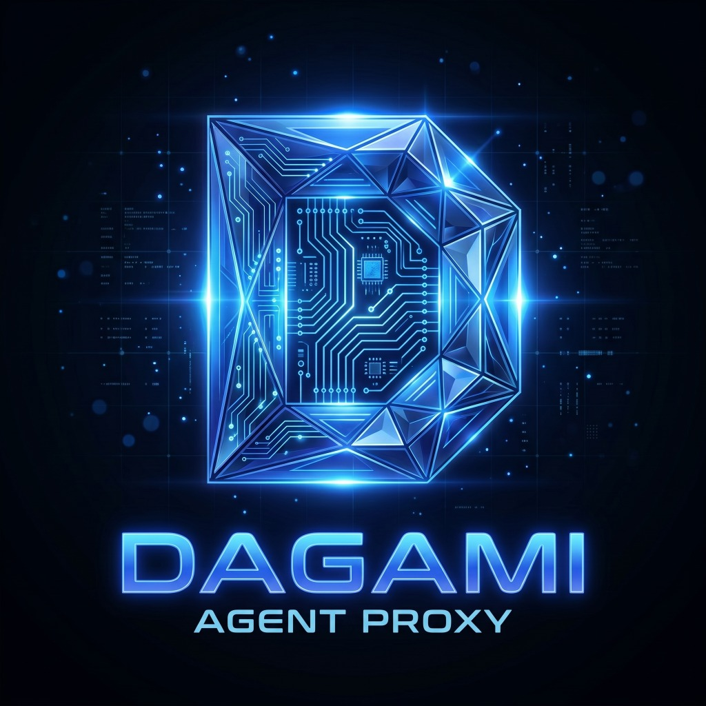

**[Группа Dagami](https://t.me/dagamvi) | [Канал Dagami](https://t.me/dagamivibe) | [Донаты](https://pay.cloudtips.ru/p/671fda86) | dns.dagami.ru | [Обсуждение и техподдержка](https://t.me/dagamvi/2140) | [Сообщить об ошибке](https://dns.dagami.ru/support/agent-proxy/)**

# Dagami Agent Proxy

<p align="center">
  
</p>

Нативный менеджер запуска IDE и CLI через прокси. Windows использует WinForms,
macOS — AppKit, Linux — GTK 3.

[Скачать 0.5.0 beta](https://github.com/j46871417-ui/Dagami-Agent-Proxy/releases/tag/v0.5.0-beta)
· [Изменения релиза](RELEASE_NOTES.md)
· [Бот доступа](https://t.me/bright26bot)

**[Быстрый старт](docs/QUICK_START.md)** ·
**[Руководство пользователя](docs/USER_GUIDE.md)** ·
**[Как сделать свой форк](docs/FORKING.md)**

## Подключение

1. Получите ключ через `/key` в @bright26bot.
2. Вставьте его в окно активации или откройте «Подключение → Подключить по ключу».
3. Выберите приложение и запустите его через Dagami.

Свой HTTP/HTTPS-прокси вводится на странице «Подключение». Windows также принимает
`host:port` и `direct` для системного VPN. В macOS и Linux поддерживаются отдельные
профили HTTP, HTTPS и SOCKS5. Реквизиты сохраняются в хранилище ОС.

Для обычного запуска через ярлык или команду CLI используйте «Действия →
Настроить обычный запуск» в Windows. После изменения PATH перезапустите терминал.
[Привязка и отзыв устройств](MANAGED_ACCESS.md) · [Поддержка приложений](APPLICATIONS.md)

## Установка и требования

- Windows 10/11 с .NET Framework 4.8. Основной пакет содержит один `DagamiAgentProxy.exe`.
- macOS для Intel и Apple Silicon. Интерфейс использует AppKit, секреты — Keychain.
- Linux для x64 и ARM64. Для окна нужен GTK 3, для секретов — Secret Service и `secret-tool`.

macOS и Linux проверены кросс-компиляцией. Сборки без цифровой подписи и нотаризации.
Перед заменой Windows EXE завершите Dagami через «Выход» в трее.

[Пакеты, сборка и требования](NATIVE_NEXT.md) · [Маршрутизация](APP_ROUTING.md)

**[Группа Dagami](https://t.me/dagamvi) | [Канал Dagami](https://t.me/dagamivibe) | [Донаты](https://pay.cloudtips.ru/p/671fda86) | dns.dagami.ru | [Обсуждение и техподдержка](https://t.me/dagamvi/2140) | [Сообщить об ошибке](https://dns.dagami.ru/support/agent-proxy/)**

## Сборка и проверки

Из корня репозитория с Go 1.23 или новее выполните команду для своей ОС.

```sh
go run ./cmd/dagami-build -test -source
```

На Windows для отдельного EXE и проверок WinForms добавьте флаги.

```powershell
go run ./cmd/dagami-build -test -source -windows-native -native-checks
```

Для кросс-сборки всех архитектур используйте `-target all`. Пакеты, исходники и
SHA-256 появятся в `dist-portable/native-next`. На Windows используется системный
компилятор .NET Framework.

Настольный клиент собирается без Python. Python используется сервисом баг-репортов,
адаптерами рабочего бота и частью тестовых инструментов.
[Проверки Windows](tests/native/README.md) · [Правила исходников](SOURCE_POLICY.md)

## Состав репозитория

| Каталог | Назначение |
| --- | --- |
| `src/` | Нативный Windows-клиент, прокси-мост, патчи и DNS |
| `cmd/` | Go-клиент, шлюз и единый сборщик |
| `internal/` | Переносимый интерфейс, транспорт и управляемый доступ |
| `assets/` | Используемые иконки и логотип |
| `tests/native/` | Windows-фикстуры |
| `deployment/managed/` | Серверный unit и адаптеры Telegram |
| `bug_reports/` | Сервис и форма баг-репортов |
| `tools/` | Расширенный прогон Windows-проверок |

Прежний Python/Tk-клиент и его установщики доступны в истории Git и в теге
`v0.5.0-beta`.

## Документация

[Краткая инструкция](docs/QUICK_START.md) · [Полное руководство](docs/USER_GUIDE.md)
· [Разработка и выпуск форков](docs/FORKING.md)

[DNS и откат](SYSTEM_DNS.md) · [Автозапуск Windows](STARTUP.md)
· [Баг-репорты](BUG_REPORTS.md) · [Сервер управляемого доступа](MANAGED_ACCESS.md)
· [История изменений](CHANGELOG.md) · [Сторонние компоненты](THIRD_PARTY_NOTICES.md)

Управляемый запуск передаёт прокси совместимым приложениям. Приложения с собственным
сетевым стеком, WSL, SSH, контейнеры и удалённые процессы требуют отдельной настройки.
Проверка маршрута подтверждает сетевой ответ, а вход и доступ к моделям проверяются
в самом сервисе. Системный DNS и его полный сброс доступны отдельными действиями
с резервной копией и подтверждением.

**[Группа Dagami](https://t.me/dagamvi) | [Канал Dagami](https://t.me/dagamivibe) | [Донаты](https://pay.cloudtips.ru/p/671fda86) | dns.dagami.ru | [Обсуждение и техподдержка](https://t.me/dagamvi/2140) | [Сообщить об ошибке](https://dns.dagami.ru/support/agent-proxy/)**
